<p align="center">
  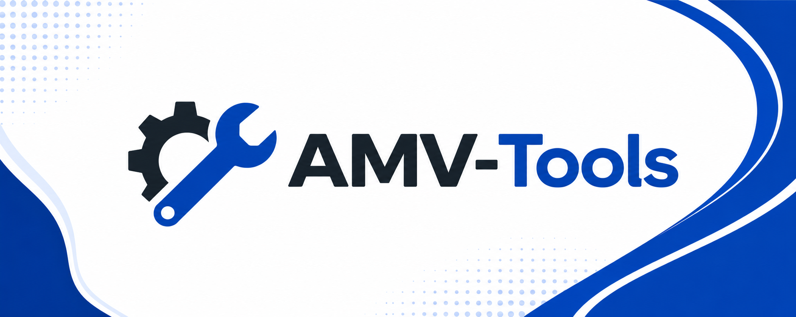
</p>

<p align="center">
  <a href="https://github.com/leandro-dbb/AMV-Tools/releases/tag/v0.5.0-beta.4"></a>
  
  <a href="LICENSE"></a>
  
</p>

<h3 align="center">Stop scrubbing. Start editing.</h3>

<p align="center">
  <strong>Every shot of every episode, one search away.</strong><br>
  AMV Tools indexes your anime episodes on your own machine, then lets you find, derush,
  sync to music and send the shots straight to your editor.
</p>

<p align="center">
  <a href="https://github.com/leandro-dbb/AMV-Tools/releases/download/v0.5.0-beta.4/AMV-Tools-promo.mp4">
    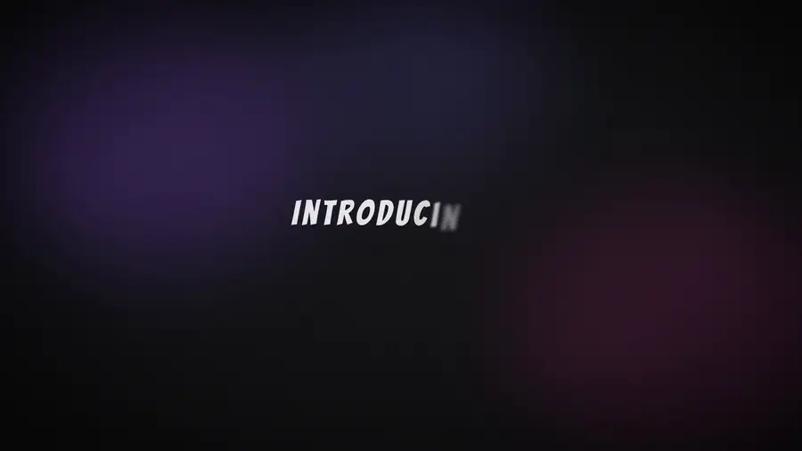
  </a>
  <br>
  <sub>▶ <a href="https://github.com/leandro-dbb/AMV-Tools/releases/download/v0.5.0-beta.4/AMV-Tools-promo.mp4">Watch the full promo (1 min 39, MP4)</a></sub>
</p>

<p align="center">
  <a href="https://github.com/leandro-dbb/AMV-Tools/releases/tag/v0.5.0-beta.4"></a>
  <a href="https://github.com/leandro-dbb/AMV-Tools/releases/tag/v0.5.0-beta.4"></a>
  <a href="https://github.com/leandro-dbb/AMV-Tools/releases/tag/v0.5.0-beta.4"></a>
</p>

<p align="center"><sub>Free · open source (MIT) · English &amp; French interface · your footage never leaves your disk</sub></p>

> [!WARNING]
> **Public beta.** Core flows work on real footage (tested on Windows 11 + RTX 3090,
> a MacBook M1 Pro and Debian 12 + RTX 3090), but expect rough edges. The
> **cut-out editor is a beta** and the **automatic Mask Mode stays off by default**.
> Found a bug? `Settings › Diagnostic › Copy report` and attach it to an
> [issue](https://github.com/leandro-dbb/AMV-Tools/issues).

## Why

You know the shot you want — *Goku screaming, close-up, red sky* — but not which
of your 40 episodes it lives in, or at what timestamp. AMV Tools watches the
episodes for you: it finds every cut, tags every scene and builds a visual
search index, all locally. Then you type what you see, keep what you like, and
export a timeline that points at your original files. No re-encoding, no cloud,
no account.

## Features

- [Import whole seasons](#import-whole-seasons-any-format)
- [Indexing with precise cuts](#indexing-with-precise-cuts)
- [Search: text, image, filters, similar shots, characters, tags](#search-the-way-you-think)
- [Derush like an editor](#derush-like-an-editor)
- [Collections](#collections)
- [Music sync](#music-sync--cut-on-the-beat)
- [Timeline export to your editor](#send-it-to-your-editor)
- [Finishing: upscale, slow-mo, depth](#finishing-upscale-slow-mo-depth)
- [Cut-out editor (beta)](#cut-out-editor-beta)
- [Share a database, relink in one click](#share-a-database-relink-in-one-click)
- [Windows, macOS, Linux — tuned for your machine](#windows-macos-linux--tuned-for-your-machine)

### Import whole seasons, any format

Drag & drop your episode folders (subfolders included) or pick them, give them
an optional group name (`One Piece`, `S23`…) and hit **Start indexing**. MKV,
MP4, MOV, AVI, WebM, TS/M2TS, MPG, WMV, FLV, MXF and more. You can keep
browsing, searching and derushing while it runs; indexed episodes are organised
into drag-and-drop groups.

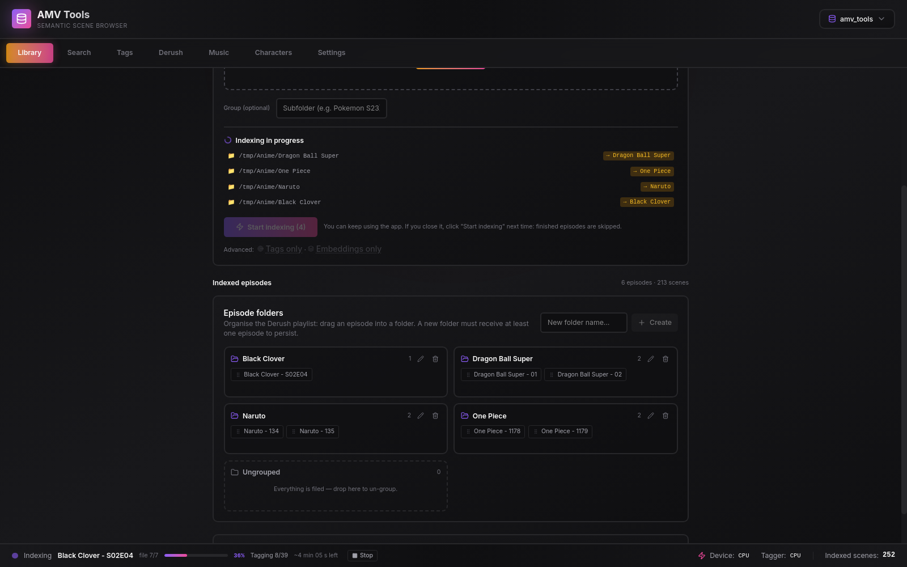

### Indexing with precise cuts

Indexing detects every hard cut, tags every scene (wd-tagger), computes its
SigLIP 2 search embedding and analyses its camera motion, intensity and colour
palette. Download the optional **TransNetV2** cut network in `Settings › Models`
(30 MB) for frame-accurate cuts in fast fights, flashes and dark shots — about
5 % more indexing time on an NVIDIA card or a Mac. Measured at the exact frame on
hand-annotated extracts: [docs/reports/coupes.md](docs/reports/coupes.md).

### Search the way you think

**Text search** across every anime of the library: type `Goku screaming`,
`explosion`, `close-up face, rain`. Hover a card to preview the shot, click it to
open the trim editor.

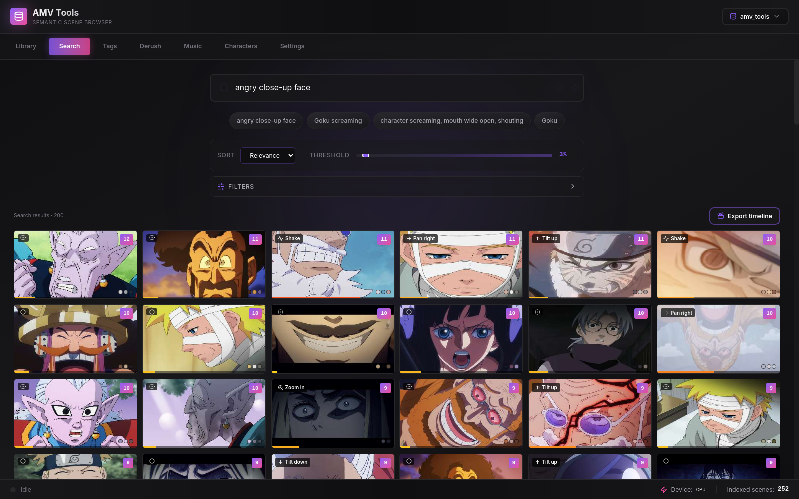

**Search by image**: drop a screenshot or a reference picture and get the shots
that look like it.

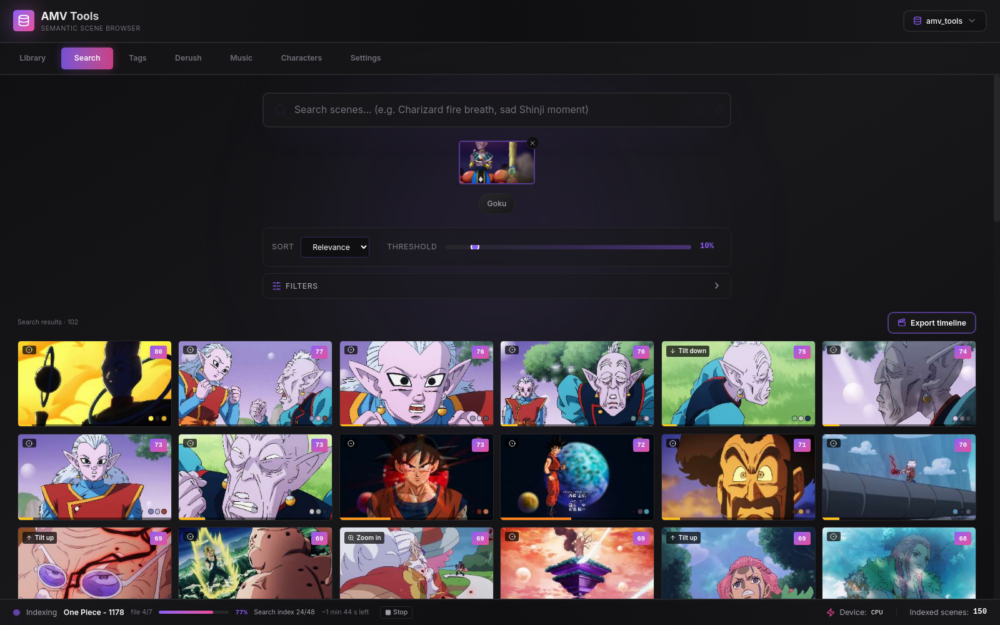

**Filters** — no words needed: characters, camera motion (static, pan, tilt,
zoom, shake), intensity, duration, dominant colour, series, favorites. Combine
them with a query or use them alone ("every zoom-in with intensity > 70 %").

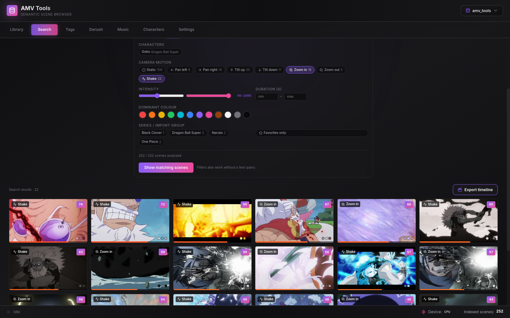

**Similar shots**: from any scene, list the nearest ones in the whole library
(optionally from other episodes only, or the same series).

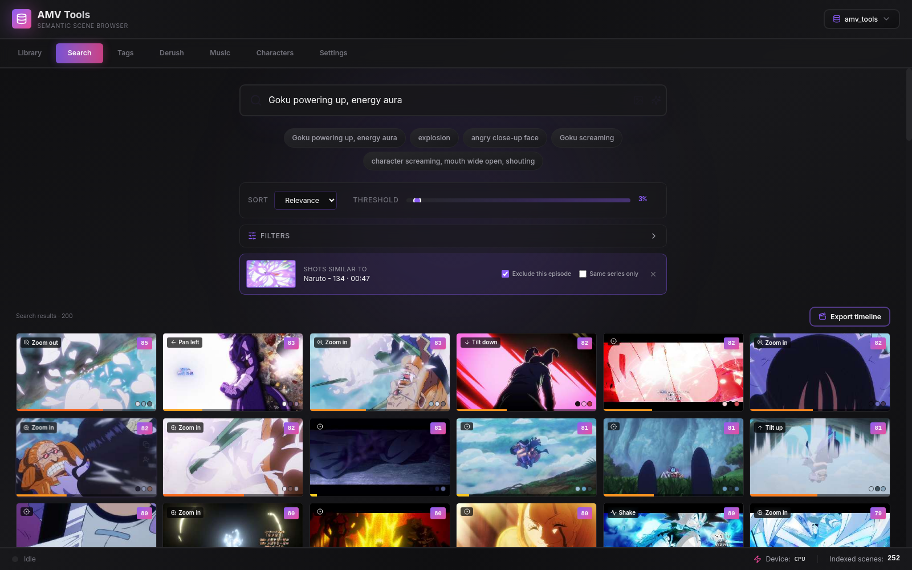

**Characters**: teach it a character from a few example scenes, dropped images
or a crop, validate or reject the results to refine it. Characters become search
filters, and naming one in a query (`gojo running`) boosts its scenes. No extra
model download.

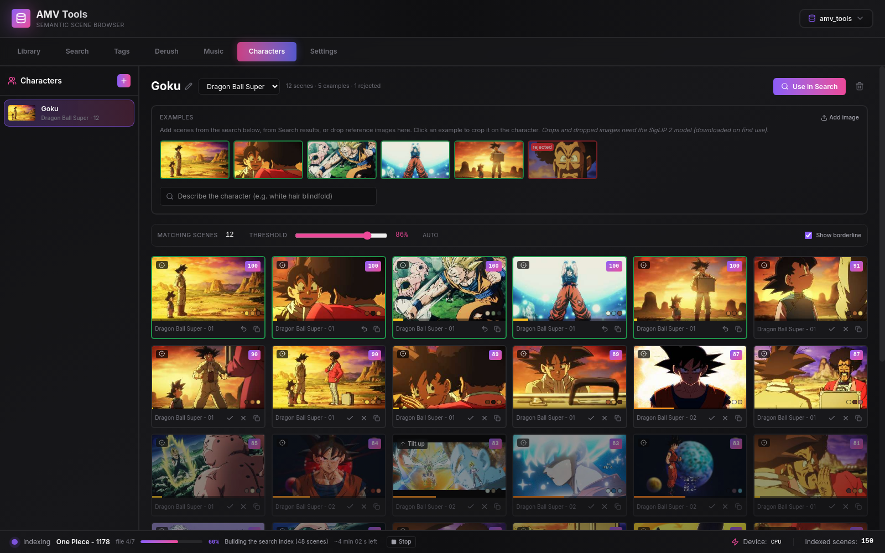

**Tags**: every scene is auto-tagged; filter by tag and episode, raise or lower
the confidence threshold, select shots and export them in a batch.

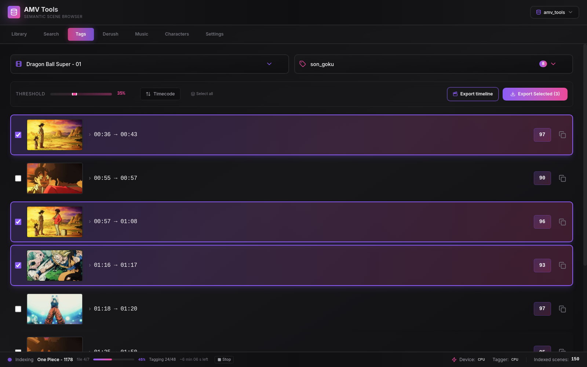

More about search: [docs/SEARCH.md](docs/SEARCH.md).

### Derush like an editor

Play whole episodes with **J/K/L** shuttle (reverse up to 10× forward), every
detected cut shown as a strip under the player. **One key keeps the scene**
under the playhead, a second press makes it a **favorite**. Arrows jump between
scenes, `,` / `.` step frames, episodes chain automatically. Keys can be
remapped in `Settings › Derush`.

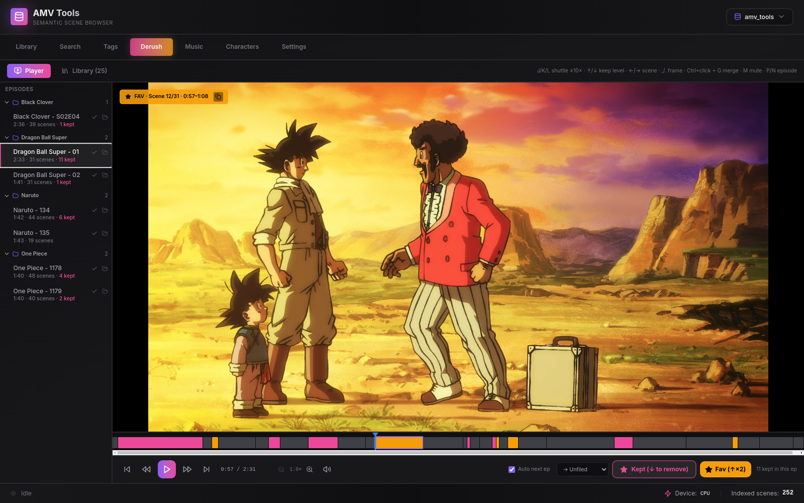

### Collections

Everything you keep lands in the derush library: hover previews, renaming,
folders (`SCREAMS`, `Power-ups`, `Sad`…), a favorites filter, and batch export of
everything, one folder or the favorites — as clips or as a timeline.

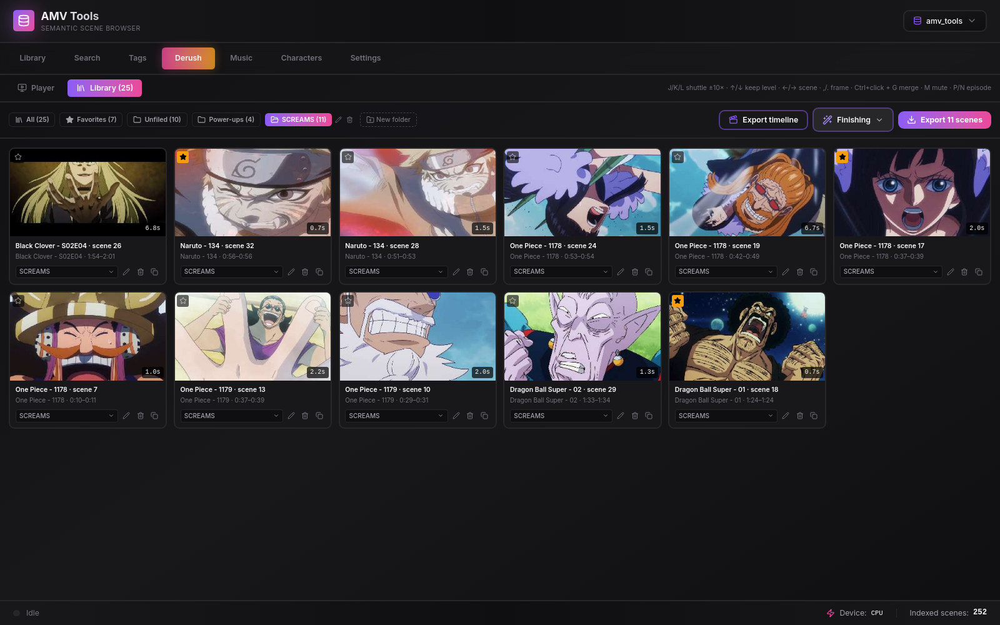

### Music sync — cut on the beat

Drop your track (mp3, wav, flac, m4a, ogg or the audio of a video). AMV Tools
finds the tempo, every beat and bar, the energy curve and the parts of the song
— intro, verse, build-up, **drop**, chorus, calm part, outro — then **proposes an
edit** with your own shots: calm shots on the calm parts, action cut on 1-2 beats
on the drop. Swap, lock, regenerate, preview with the music, and export the edit
as a timeline with beat and section markers (or just the markers). Every cut sits
on the frame nearest to its beat. Runs on any CPU; the optional Beat This!
model (8.5 MB) places the bar lines more accurately.

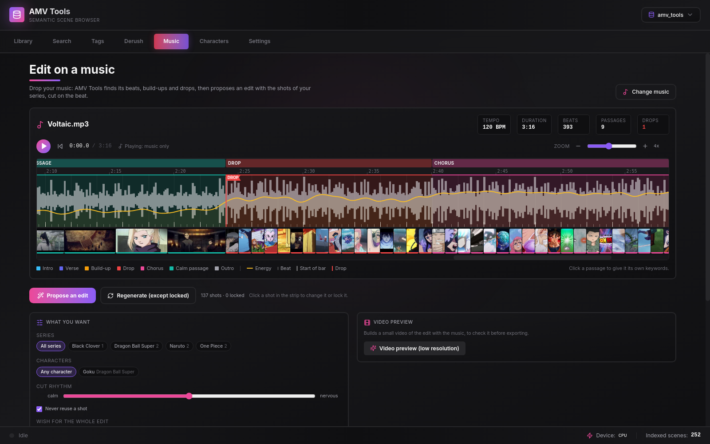

Details: [docs/MUSIC-SYNC.md](docs/MUSIC-SYNC.md).

### Send it to your editor

Export a selection, a collection, search results or a music edit as a **timeline
of cuts that points at your original files** — nothing is re-encoded, in/out
points are frame-accurate, mixed frame rates are handled.

| Editor | Format |
| --- | --- |
| Premiere Pro | FCP 7 XML |
| DaVinci Resolve | FCPXML / FCP 7 XML / OTIO |
| After Effects | `.jsx` script (comp built for you) |
| Vegas Pro | Vegas EDL text |
| Final Cut Pro | FCPXML 1.9 |
| Anything else | EDL CMX3600, OpenTimelineIO |

Options: frame rate and resolution, gaps, handles, markers and labels, source
audio, and **Collect media** (copy the sources next to the timeline to hand the
project to someone else). Formats, options and import steps per editor:
[docs/TIMELINE-EXPORT.md](docs/TIMELINE-EXPORT.md) — 5-minute checklist (FR):
[docs/import-timeline.md](docs/import-timeline.md).

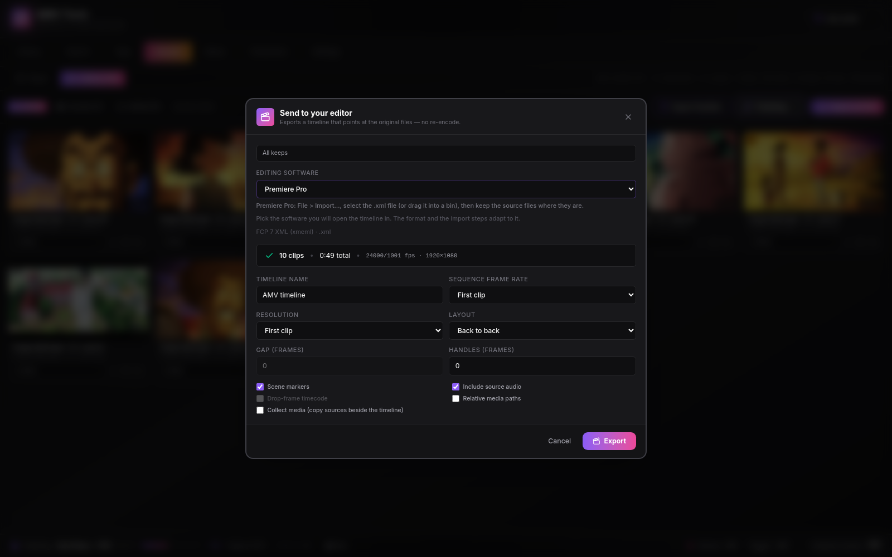

### Finishing: upscale, slow-mo, depth

From the trim editor or a collection, the **Finishing** menu runs local AI passes
as background jobs (queue, progress, ETA, cancel) and writes new files next to
your exports:

- **Upscale** ×2 / ×4 — AnimeJaNai HD V3, Real-ESRGAN anime;
- **Slow-mo / 60 fps** — RIFE 4.26 (×2/×4/×8, or 48/50/60 fps at the same
  duration), with an option not to morph across cuts;
- **Depth map** — Video Depth Anything, for parallax / 3D layers in After Effects.

*Estimate time* benchmarks the model on 5 real frames of your clip first. Models
download on demand. Some of them are **non-commercial** — see
[models and licenses](#models-and-licenses).

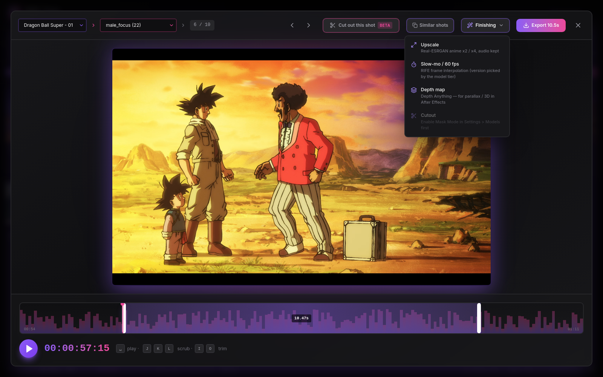

### Cut-out editor (beta)

Press **Cut out this shot**: the AI makes the first pass over the whole shot,
then you fix what it got wrong the way Roto Brush (After Effects) or Magic Mask
(Resolve) work — brush to add/remove, click a missing part, propagate the fix
along the shot, jump to the frames flagged *to check*. Export ProRes 4444 with
alpha, a PNG sequence or the black-and-white matte. Works on NVIDIA, Apple
Silicon and CPU (slower). It is a **beta**: big defects are fixed in a few
strokes, edges are not pixel-perfect. The fully automatic **Mask Mode** is still
off by default (`Settings › Models`). Details: [docs/ROTO.md](docs/ROTO.md).

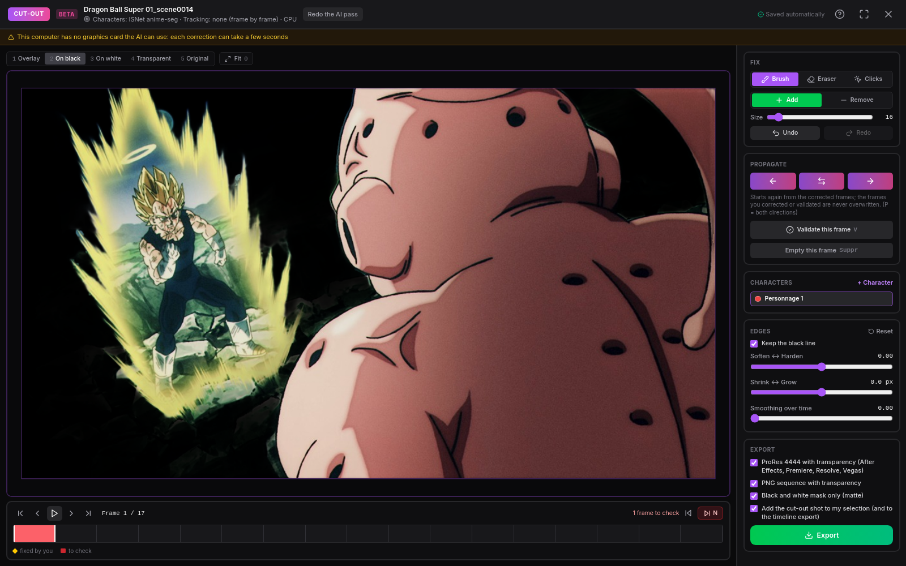

### Share a database, relink in one click

One database = one library (e.g. one per project). Send your `.db` to a friend:
they open it from `Library › Databases (advanced) › Open existing`, and if the
episodes are somewhere else on their machine the **relink** panel re-points them by folder, season or file.
Scenes, tags, embeddings and keeps survive — no re-indexing.

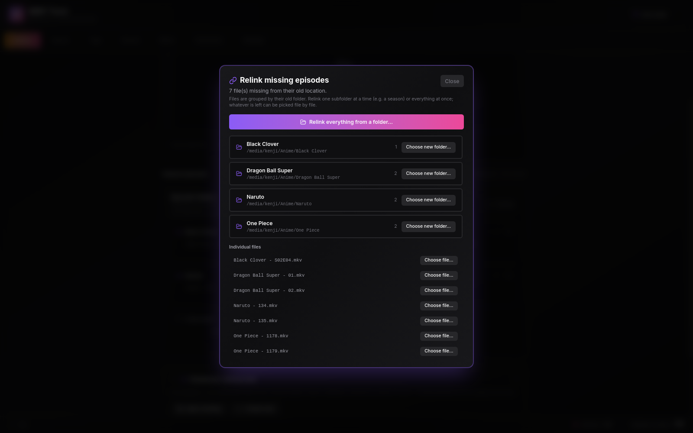

### Windows, macOS, Linux — tuned for your machine

NVIDIA (CUDA), Apple Silicon (Metal + Core ML / Neural Engine) and CPU. The
**model tier** picks the best models for your VRAM or unified memory, and the
**automatic tuning** measures the decode and batch settings on *your* machine on
first launch (and again after a GPU, driver or app update). `Settings ›
Diagnostic` shows what was chosen and why, the active GPU, model states and
recent errors, with a **Copy report** button for bug reports.

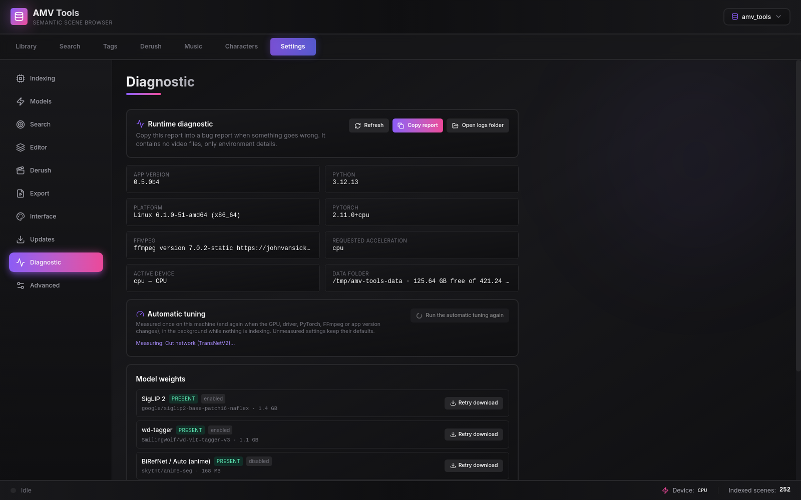

## Download and install

Get the files from the [**v0.5.0-beta.4 release**](https://github.com/leandro-dbb/AMV-Tools/releases/tag/v0.5.0-beta.4).

| System | File | How to open |
| --- | --- | --- |
| **Windows 10/11 x64** | `AMV.Tools.Setup.0.5.0-beta.4.exe` | The installer is not signed yet: SmartScreen → **More info → Run anyway**. On first launch Windows may ask to install *Microsoft Visual C++*: accept. |
| **macOS on Apple Silicon** (M1 and newer) | `AMV.Tools-0.5.0-beta.4-arm64.dmg` (or `.zip`) | Signed with a Developer ID and notarized by Apple: drag into Applications and open. |
| **Linux x64** | `AMV.Tools-0.5.0-beta.4.AppImage` or `amv-tools_0.5.0-beta.4_amd64.deb` | AppImage: `chmod +x` it and run; it needs `libfuse2` (`libfuse2t64` on Ubuntu 24.04) **and** `fusermount` (`sudo apt install fuse3`). Or `sudo apt install ./amv-tools_0.5.0-beta.4_amd64.deb`, which needs neither. |

On first launch AMV Tools picks the engine for your hardware and downloads
PyTorch (a few hundred MB for CPU, about 5 GB for NVIDIA CUDA 13), then the
analysis models (~2 GB) at the first indexing. An interrupted install is
repaired automatically at the next launch.

> [!IMPORTANT]
> **Windows Smart App Control** (on by default on some Windows 11 machines)
> blocks unsigned installers with no "Run anyway" option. If nothing happens
> when you launch the installer, check `Windows Security › App & browser
> control › Smart App Control`.

More (NVIDIA drivers, clean reinstall, moving a library, logs): [docs/INSTALL.md](docs/INSTALL.md).

### Requirements

- Windows 10/11 64-bit, macOS 12+ on Apple Silicon, or a recent Linux x64
  (Ubuntu 22.04+, Debian 12).
- 16 GB RAM recommended (8 GB minimum), ~15 GB free disk.
- GPU: NVIDIA RTX 20 or newer (driver ≥ 581 on Windows / 580 on Linux for
  CUDA 13 and RTX 50), or Apple Silicon. AMD / Intel on Windows (DirectML) are
  wired in but not validated. **CPU-only works**, just much slower.

### Measured speed

One 24-min 1080p episode, from start of indexing to searchable:

| Machine | Time per episode |
| --- | --- |
| MacBook Pro M1 Pro 16 GB (macOS) | **~2 min** ([PERFORMANCE.md](docs/PERFORMANCE.md)) |
| Windows 11 + RTX 3090 | **~2 min 15** ([report](docs/reports/windows-rtx3090.md)) |
| Debian 12 + RTX 3090, VM with 6 vCPU (AppImage) | **~3 min 20 – 3 min 40** (3 min 36 in the [installer test](docs/reports/test-installeurs-linux-mac.md)) |

Honest caveat: these runs used real episodes but not strictly identical
profiles or settings (Accurate profile, with or without the optional TransNetV2
cut network, warm or cold caches); read the linked reports for the exact
conditions. NVIDIA details: [docs/PERFORMANCE-NVIDIA.md](docs/PERFORMANCE-NVIDIA.md).

### Known issues

- Windows installer not signed (SmartScreen warning, see above).
- Automatic Mask Mode is off by default; the cut-out editor is a beta.
- Not verified yet: real import of the timelines in every NLE, RTX 50 cards,
  AMD / Intel (DirectML), Linux on a real desktop (KDE / GNOME, Wayland), the
  cut-out editor on Windows. Please report!
- AppImage on Ubuntu 24.04: if it does not start (Chromium sandbox /
  AppArmor), use the `.deb` or run it with `--no-sandbox`.

## Models and licenses

AMV Tools itself is **MIT**. Model weights are **never bundled**: they are
downloaded on demand from their official source (license-checked, throttled,
checksum-verified) and can be deleted at any time.

- Search, tags and cuts: SigLIP 2 (Apache-2.0), wd-tagger v3 (Apache-2.0),
  TransNetV2 (MIT / Apache-2.0 weights). Music analysis: librosa (ISC) and Beat
  This! (MIT).
- Finishing: Real-ESRGAN (BSD-3-Clause), RIFE (MIT), Video Depth Anything Small
  (Apache-2.0), 2xHFA2kAVCCompact (CC-BY-4.0).
- Cut-outs: BiRefNet (MIT), SAM 2.1 (Apache-2.0), SAM 3 (SAM License, gated:
  your own Hugging Face token).
- **Non-commercial models**: AnimeJaNai HD V3 (**CC-BY-NC-SA-4.0**, used by the
  default upscale tiers) and Video Depth Anything Large (**CC-BY-NC-4.0**, *Max
  quality* tier on NVIDIA) forbid commercial use; they are marked *non-commercial
  use* in `Settings › Models`. If you use AMV Tools or its output commercially,
  pick a permissive model instead (`Custom` tier, 2xHFA2kAVCCompact, Video Depth
  Anything Small). MatAnyone (S-Lab, non-commercial) is not shipped.

Full tables (sizes, tiers per GPU, licenses): [docs/MODELS.md](docs/MODELS.md).

## Privacy

AMV Tools runs locally. Your videos, thumbnails, embeddings, tags, settings and
exports stay on your machine unless you move or share them yourself. The only
downloads are the app engine and the model weights (PyTorch, Hugging Face and
the models' upstream repositories). AMV Tools ships no media: it indexes the
files you give it. The screenshots above use local test footage.

## Build from source and contribute

```bash
uv sync --extra cpu          # or cu126 / cu130 / mps
cd app && npm install
npm run dev:electron
```

Tests, end-to-end UI journey, installers, macOS builds and the repository
layout: [docs/DEVELOPMENT.md](docs/DEVELOPMENT.md). Releasing:
[docs/RELEASING.md](docs/RELEASING.md). Contributing:
[CONTRIBUTING.md](CONTRIBUTING.md). Changes: [CHANGELOG.md](CHANGELOG.md).

## License

MIT — see [LICENSE](LICENSE). Model weights keep their own licenses (above).
