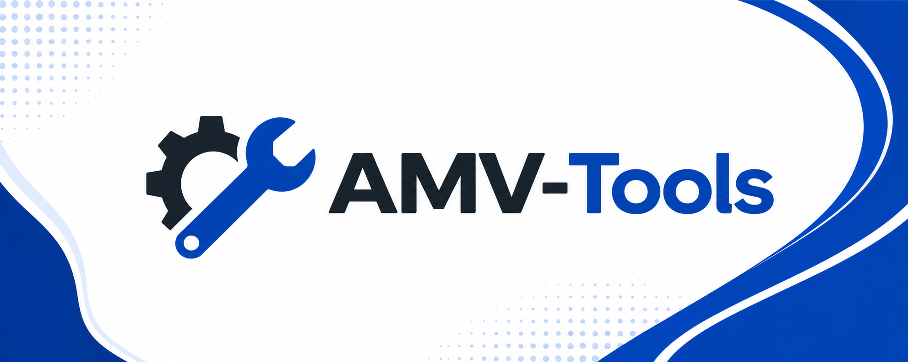
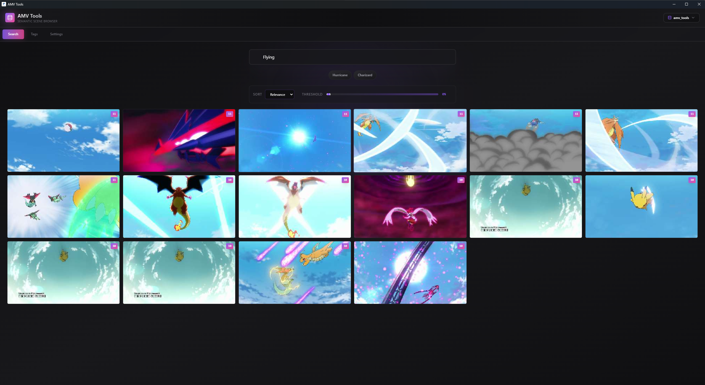
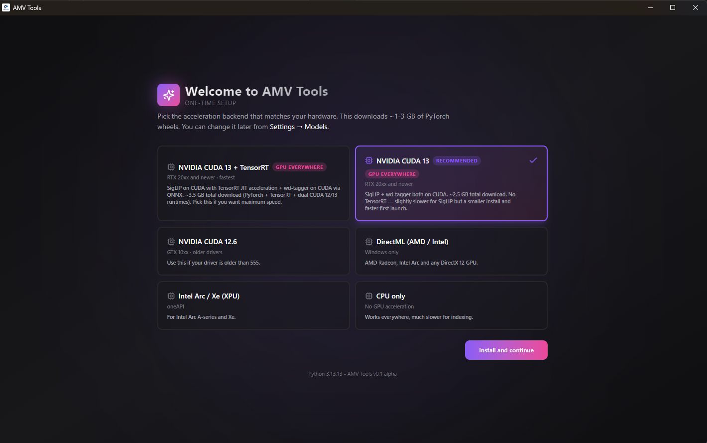
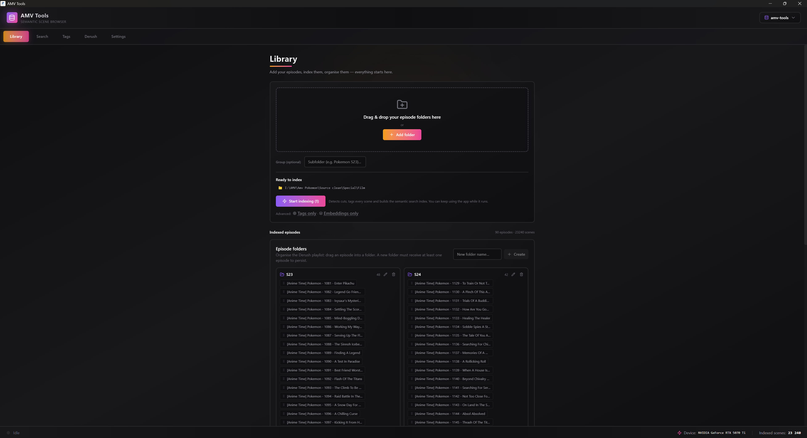
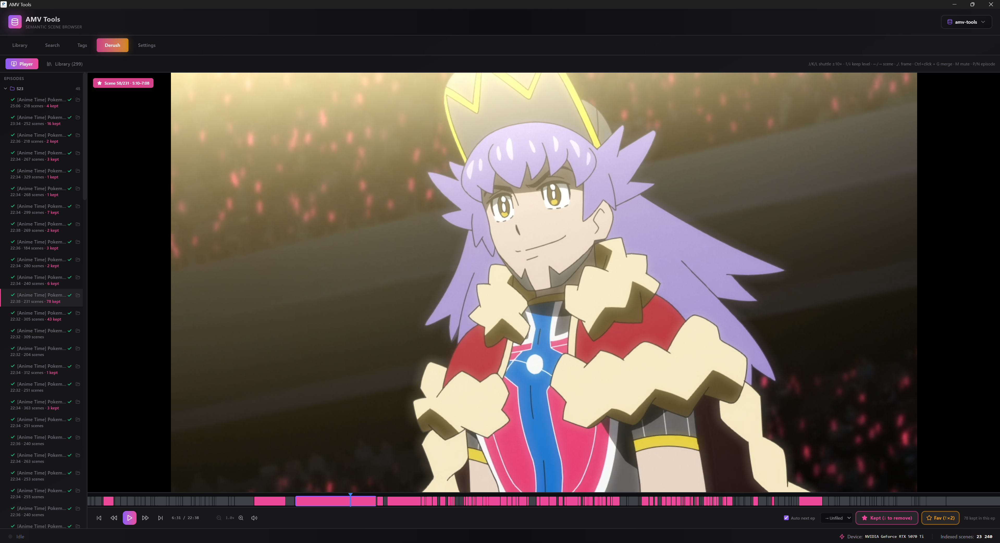
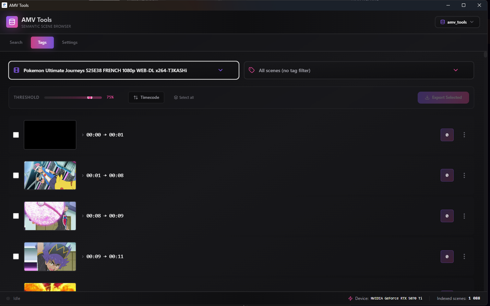
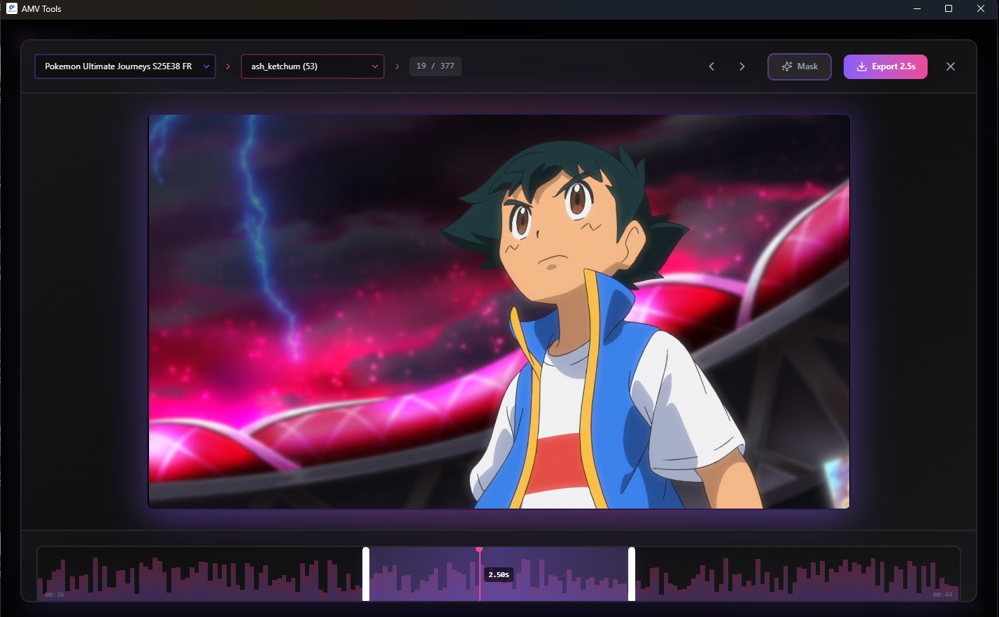
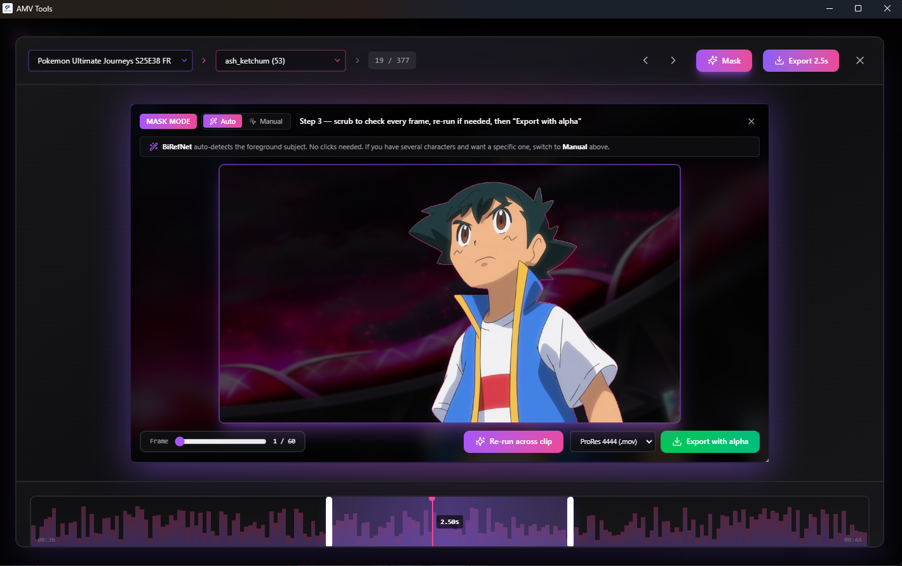

# AMV Tools

<p align="center">
  
</p>

<p align="center">
  <strong>Find the anime shot in your head, trim it, mask it, export it.</strong><br>
  A local-first desktop scene browser for AMV editors and anime clip workflows.
</p>

> [!WARNING]
> **AMV Tools is beta software and is not production-ready.** It still has rough
> edges and bugs: GPU detection can fall back to CPU, model downloads can fail,
> and several flows break on real-world footage. Use it to experiment, not to
> ship. The **roto / alpha-matte (Mask Mode)** feature in particular is **far
> from ready and disabled by default** — matte quality is unreliable. You can
> opt in from `Settings > Models`, but treat it as an experiment.

AMV Tools turns a folder of episodes into a fast, visual editing library. It
indexes your footage locally with semantic search and anime-oriented tags, lets
you derush whole seasons with an Adobe-style player, browse shots by prompt or
tag, then gives you a focused mini editor for clip exports and experimental
alpha-matte cutouts.

The interface is available in **English and French** — switchable live from
`Settings > Interface`, auto-detected from your system on first launch.



## Why It Exists

Editing anime clips should not mean scrubbing through hours of footage trying
to remember where one two-second shot lives. AMV Tools is built for the moment
when you know the vibe, character, color, action, or composition you want, but
not the exact episode timestamp.

- Derush entire seasons with a J/K/L shuttle player and one-key scene keeping.
- Search scenes with natural-language prompts like `Charizard`, `Gojo combat`,
  or `red sky close-up`.
- Browse anime tags generated locally with wd-tagger.
- Trim clips frame-aware before export, alone or in batches.
- Build multiple local SQLite libraries for different projects, and move them
  between machines with one-click relinking.
- Export normal clips or experiment with character cutouts using alpha video.

## Product Tour

### 1. Guided First Launch

On first launch, AMV Tools asks three things: your **acceleration backend**
(NVIDIA CUDA recommended, CPU as the safe fallback — the heavy PyTorch download
only happens for the backend you pick), whether indexing should favor **speed
or accuracy**, and your **language** (English/Français). Everything can be
changed later in Settings.



### 2. The Library Tab — Everything Starts Here

Drop a folder of episodes, optionally give it a group name (`S23`), hit
**Start indexing**. AMV Tools detects cuts, sub-segments long scenes, generates
tags, creates embeddings, and stores everything locally. While it runs you can
already browse what's done. Indexed episodes are organised into drag-and-drop
folders that structure the Derush playlist.



Databases live behind the *advanced* disclosure at the bottom: one database per
project, importable from another PC — when episode files are missing, a relink
panel re-points them by folder, by season, or file by file.

### 3. Derush Episodes Like An Editor

The Derush player plays whole episodes with Adobe-style **J/K/L** shuttle
(reverse to 10× forward), shows every detected cut as a strip under the player,
and keeps the scene under the playhead with a single key. One press keeps,
a second promotes to **favorite** (gold). Episodes chain automatically, arrows
jump between scenes, `,`/`.` step frames, Ctrl+click + G merges over-split
scenes.



### 4. A Library Of Keeps, Ready To Export

Everything you keep lands in the Derush library: hover previews, renaming,
folders, favorites filter, and batch export of the whole selection (or one
folder) in a single click.


### 5. Browse By Tags

The tag browser is made for scanning. Filter a video, raise or lower the
confidence threshold, select the shots you want, and export them as a batch.



### 6. Search Like An Editor

Semantic search gives you a contact sheet of matching shots instead of forcing
you to remember filenames. Sort by relevance, tune the threshold, and hover
through results until the right movement, pose, or color lands. You can also
drop an image to search by visual reference.


**Finer search (v0.4).** Every scene also gets a camera-motion label (static,
pan left/right, tilt up/down, zoom in/out, shake) with a magnitude, an
intensity score (motion, rapid sub-cuts, flashes, luminance swings) and a
3-colour palette. They are computed on CPU during indexing from the frames the
cut detector already decodes, and older libraries are analysed in the
background shortly after launch (progress in the status bar; turn it off in
`Settings > Search > Automatically analyse existing scenes` and run it on
demand from `Filters > Analyse existing scenes`) — no re-index needed. The collapsible **Filters** panel combines
characters, motion, intensity, duration, dominant colour, series and favorites
with a text or image query — or on their own ("every zoom-in of Gojo with
intensity > 70 %"). Cards show a motion icon, an intensity bar and the palette.

**Similar shots.** From any scene — Search, Tags, Derush, the mini editor —
`Similar shots` lists the nearest scenes by their existing SigLIP 2 embedding
(optionally excluding the same episode or staying in the same series).

**Characters.** The Characters tab turns a few example scenes (or dropped
reference images, or a crop of a scene around the character) into a SigLIP 2
prototype, scores every scene of the chosen series, and lets you validate or
reject results to refine it. Characters are saved in the library and work as
search filters, and naming one in a query ("gojo running") boosts its scenes.
No extra model is downloaded: crops and dropped images reuse SigLIP 2, plain
scene examples reuse the stored embeddings.

### 7. Trim Before Export

Open a result in the mini editor, scrub the clip, adjust the trim handles, and
export exactly the duration you need — designed for short, repeatable clip
pulls, not full timeline editing.



### 8. Experiment With Alpha Cutouts (beta, off by default)

Mask Mode runs a local roto workflow for short clips. **Still disabled by
default** — enable it from `Settings > Models`. BiRefNet / ISNet anime can
auto-detect the foreground subject, SAM 2 helps with manual selection, and the
exporter can write alpha formats such as ProRes 4444 or VP9 with transparency.
Since 0.4 you can click on any frame (each one becomes a keyframe), paint
corrections with an add/remove brush, re-propagate, and review the cutout on a
checkerboard or a solid colour. Measured matte quality is good on clean shots
but still poor on motion-blurred action — see [Rotoscope Notes](#rotoscope-notes).
BiRefNet (MIT) and SAM 2 (Apache-2.0) download on demand; BiRefNet is pinned
to a fixed upstream revision. **MatAnyone is not shipped**: its S-Lab 1.0
license is **non-commercial**, so if you install it yourself (see
`pyproject.toml`), Mask Mode's Auto engine uses it and your cutouts fall
under that license.



### 9. Finishing Toolbox — Prepare The Material, Not Just Find It

From the mini editor (on the trimmed clip) or from the selects library (on every
clip shown), the **Finishing** menu runs local AI passes and writes a new file
to `<export folder>/finish/`:

| Pass | Model | What you get |
|---|---|---|
| **Upscale** x2 / x4 | AnimeJaNai HD V3 UltraCompact (per model tier, non-commercial), Real-ESRGAN AnimeVideo v3 (fast, steady) or x4plus anime 6B (sharper) | Upscaled clip with the source audio, using your export codec. Tiled inference keeps VRAM bounded. |
| **Slow-mo / 60 fps** | RIFE 4.26 (or 4.26 heavy, per model tier) | x2/x4/x8 slow motion (audio muted or time-stretched) or 48/50/60 fps at the same duration (audio kept). *Don't interpolate across cuts* duplicates frames at hard cuts instead of morphing two shots. |
| **Depth map** | Video Depth Anything Small (Large in *Max quality* on NVIDIA; Depth Anything V2 Small on 8 GB Macs and the Mac *Fast* tier) | Grayscale depth (white = near), frame-synchronous with the clip, as a 16-bit PNG sequence, ProRes 422 HQ (10-bit) or H.264. Optional temporal smoothing. Made for parallax / 3D layers in After Effects. |
| **Cutout** | Mask Mode's Auto engine | ProRes 4444 / VP9 alpha in one click (requires Mask Mode). |

Every pass is a background job: queue as many as you like, follow progress and
ETA in the floating **Finishing** queue (bottom right), cancel, or reveal the
file. *Estimate time* benchmarks the model on 5 real frames of your clip before
you commit. Without a GPU everything still works on the CPU, just slowly — the
dialog warns you.

Models are **not** bundled: download them on demand from `Settings > Models >
Finishing models` (or from the dialog). Downloads are throttled to 10 MB/s,
checksum-verified, and can be deleted at any time.

| Model | Size | License |
|---|---|---|
| Real-ESRGAN `realesr-animevideov3` | 2.5 MB | BSD-3-Clause |
| Real-ESRGAN `RealESRGAN_x4plus_anime_6B` | 18 MB | BSD-3-Clause |
| `2xHFA2kAVCCompact` by Philip Hofmann ([Phhofm/models](https://github.com/Phhofm/models)) | 4.8 MB | CC-BY-4.0 (attribution: Philip Hofmann) |
| `2x_AnimeJaNai_HD_V3_UltraCompact` by the-database ([mpv-upscale-2x_animejanai](https://github.com/the-database/mpv-upscale-2x_animejanai), official `ModelsOnly` archive, only this file is kept) | 24.7 MB download, 2.5 MB on disk | **CC-BY-NC-SA-4.0 — non-commercial use only** (attribution: the-database) |
| RIFE 4.25 / 4.25 lite / 4.26 / 4.26 heavy (Practical-RIFE, mirrored by vs-rife) | 25 MB each | MIT |
| Depth Anything V2 **Small** | 99 MB | Apache-2.0 (Base/Large are CC-BY-NC and deliberately not offered) |
| Video Depth Anything **Small** (temporally stable, code vendored in `backend/finish/archs/vda`) | 116 MB | Apache-2.0 |
| Video Depth Anything **Large** (same code, *Max quality* tier on NVIDIA) | 1.5 GB | **CC-BY-NC-4.0 — non-commercial use only** |

**Non-commercial models.** AMV Tools is a free, non-commercial tool, so it
also offers models whose license forbids commercial use (marked *non-commercial
use* in `Settings > Models`). Their weights are never committed or bundled:
they are downloaded on demand from the official source. If you use AMV Tools
or its output commercially, pick a tier or model with a permissive license
(`Custom` + the finishing menu let you choose 2xHFA2kAVCCompact or Video Depth
Anything Small instead).

Which of them a job uses by default follows the **model tier** (below).

RIFE runs as native PyTorch rather than ONNX: the 4.25 network has no custom
ops, loads the official weights directly on CUDA, MPS and CPU, and avoids a
per-resolution ONNX export.

On Apple Silicon the same weights are additionally compiled with Core ML
(`coremltools`, BSD-3-Clause, part of the `mps` extra) the first time a model
meets a new frame size: the upscale shares its frames between the GPU and the
Neural Engine, RIFE, Depth Anything and the wd-tagger run on the GPU through
Core ML (1.4–2x faster than PyTorch MPS). The compiled programs are cached
next to the model files; set `AMV_COREML=0` / `AMV_ANE=0` to stay on MPS.

### Model Tiers — The Best Models For Your GPU

`Settings > Models > Model tier` picks every model (search embeddings,
tagger, upscale, interpolation, depth) for your memory size. **Auto** reads
the VRAM (NVIDIA) or the unified memory (Mac); you can force a tier, *Fast*,
*Max quality* or *Custom* (your own per-model choices). The choices come from
measurements on three real episodes (hand-judged search and tag sets, x2
upscale and frame-interpolation references, depth flicker) on an RTX 3090
and an M1 Pro — see [docs/reports/chantier-4-modeles.md](docs/reports/chantier-4-modeles.md)
and, for the non-commercial models, [docs/reports/chantier-4b-modeles-non-commerciaux.md](docs/reports/chantier-4b-modeles-non-commerciaux.md).

| Tier | Search | Tagger | Upscale | Interpolation | Depth |
|---|---|---|---|---|---|
| Fast | SigLIP 2 base | wd-vit v3 | AnimeJaNai V3 UltraCompact | RIFE 4.26 | Video Depth Anything Small, 364 px (Mac: DA V2 Small, 364 px) |
| NVIDIA 8 / 12 GB | SigLIP 2 so400m | wd-vit v3 | AnimeJaNai V3 UltraCompact | RIFE 4.26 | Video Depth Anything Small, 364 px |
| NVIDIA 16 / 24 GB | SigLIP 2 so400m | wd-vit v3 | AnimeJaNai V3 UltraCompact | RIFE 4.26 | Video Depth Anything Small, 518 px |
| Mac 8 GB | SigLIP 2 base | wd-vit v3 | AnimeJaNai V3 UltraCompact | RIFE 4.26 | DA V2 Small (Core ML) |
| Mac 16 GB | SigLIP 2 base | wd-vit v3 | AnimeJaNai V3 UltraCompact | RIFE 4.26 | Video Depth Anything Small, 364 px |
| Mac 24 / 32 GB+ | SigLIP 2 so400m | wd-vit v3 | AnimeJaNai V3 UltraCompact | RIFE 4.26 | Video Depth Anything Small, 364 px |
| Max quality | SigLIP 2 so400m, 256 patches | wd-eva02-large v3 (Mac: wd-vit v3) | AnimeJaNai V3 UltraCompact | RIFE 4.26 heavy | Video Depth Anything Large, 364 px (Mac: Small, 364 px) |
| CPU / DirectML / XPU | unchanged defaults | | | | |

Changing the search model asks for an **embeddings-only re-index** (cuts,
tags and keeps are kept, progress shown, cancellable); until it is done the
library keeps searching with the model it was indexed with, and every
library remembers its own model. Models download on demand (10 MB/s,
checksum-verified) and only after their license has been checked against an
allow-list (Apache-2.0, MIT, BSD, CC-BY-4.0, CC0, and the non-commercial
CC-BY-NC-4.0 / CC-BY-NC-SA-4.0, flagged in Settings).

| Model | Size | License |
|---|---|---|
| SigLIP 2 base / so400m NaFlex (google) | 1.5 / 4.5 GB | Apache-2.0 |
| wd-vit / wd-eva02-large tagger v3 (SmilingWolf) | 0.4 / 1.3 GB | Apache-2.0 |

## Send To Your Editor

AMV Tools can hand a selection to a real NLE as a **timeline of cuts** that
points at the original media. Nothing is re-encoded: every writer stores the
source path plus frame-accurate in/out points, so the editor sees the exact
frames you picked.

Where the button lives:

- **Derush → Library**: the current filter (all keeps, a folder, favorites or
  unfiled) is exported.
- **Tags**: the selected scenes.
- **Search**: the current result set.

The dialog asks which editor you use (Premiere Pro, DaVinci Resolve, After
Effects, Vegas Pro, Final Cut Pro, Other), shows how to import there, previews
the clip count and total duration, then asks where to save the timeline.
Step-by-step import guide with a 5-minute checklist per editor (FR):
[docs/import-timeline.md](docs/import-timeline.md). Formats:

| Format | Best for | Notes |
| --- | --- | --- |
| **FCP 7 XML** (xmeml v5) | Premiere Pro (also Resolve) | Exact integer-frame in/out, NTSC flag, labels, markers; `pathurl` spelled like Premiere's own exports (`file://localhost/C%3a/...`). |
| **FCPXML 1.9** | Final Cut Pro 10.4+, Resolve | Rational times (`1001/24000s`), mixed source rates. |
| **EDL CMX3600** | Any NLE, as a universal cut list | 8-char reel names; `* FROM CLIP NAME:` / `* FROM FILE:` comments on one line each (what NLEs relink from). |
| **OpenTimelineIO** | Resolve, Kdenlive, OTIO tools | Native OTIO JSON (with markers), written by AMV Tools itself — no extra package needed. |
| **Vegas EDL text** (`.txt`) | Vegas Pro | Vegas' own event list (semicolons, milliseconds) for `File → Import → EDL Text File`; full source paths. |
| **After Effects script** (`.jsx`) | After Effects | ExtendScript that imports the sources, creates the comp and places every clip with exact in/out. |

Options in the dialog:

- **Sequence frame rate / resolution**: first clip or an explicit choice
  (23.976, 24, 25, 29.97, 30, 59.94, 60; 720p → 4K).
- **Back-to-back or gaps**: insert a configurable gap of N frames between
  clips.
- **Handles**: extend each clip by N frames before/after (clamped to the
  source).
- **Drop-frame**: for 29.97/59.94 only. Non-drop is the default.
- **Scene markers / labels / folders**: markers carry the scene name and tags
  in every format; favorites get the Mango label in FCP XML.
- **Include source audio**: omit it for a video-only assembly.
- **Collect media**: copies the originals (byte-for-byte, no transcode) into
  `<timeline>_media/` beside the timeline and points every clip at the
  copies, so you can send the timeline + its `_media` folder to another
  editor. How the paths are written depends on what each format can express:

  | Format | Media path after “Collect media” |
  | --- | --- |
  | FCPXML, OpenTimelineIO | Relative to the timeline file: `timeline_media/clip.mp4`. Moving the timeline and its `_media` folder together keeps the media linked. |
  | EDL | No media path in the format; the `* FROM FILE:` comment carries the same relative path. |
  | FCP 7 XML | **Absolute** `file://` URL of the copy, e.g. `file://localhost/C%3a/Edits/timeline_media/clip.mp4`. |

  Why FCP 7 XML stays absolute: xmeml's `<pathurl>` is a `file://` URL and
  Premiere Pro, Final Cut Pro 7, Resolve and Vegas do not resolve relative
  paths in it — a relative value imports as offline media everywhere. On the
  machine that exported, the copies open directly. On another machine, the
  importer asks to relink: point it at the `_media` folder once (Premiere:
  *Locate* with “Relink others automatically”; Resolve: *Relink Selected
  Clips* on the folder) — `<name>` holds the file name, so every clip is
  found by name in that folder.

VFR sources are approximated using their average frame rate; the preview
shows a warning. Mixed frame-rate sources are converted to the sequence rate
without retiming the media.

### Importing step by step

**Premiere Pro** — `File → Import…`, pick the exported `.xml` (FCP 7 XML).
The sequence appears in the project panel with clips already cut and the
media linked. For AE, import the same XML into Premiere, then use
`File → Adobe Dynamic Link → Import Premiere Pro Sequence` in After Effects
(or open the sequence in Premiere and `Edit → Edit in Adobe After Effects`).
If Premiere asks to relink, point it at the collected `_media` folder.

**DaVinci Resolve** — create/open a project, then
`File → Import → Timeline…` and choose the `.fcpxml` (or `.xml` / `.otio`).
Resolve maps reel names and clip labels; choose “Use source frame rate” if
prompted for mixed-rate sources. For EDL use
`File → Import → Pre-conformed EDL…` and select the sequence frame rate.

**Final Cut Pro** — `File → Import → XML…`, select the `.fcpxml`. The event
and project are created automatically. FCP 7 XML can also be imported by FCP
10 through `File → Import → XML…` in most versions; FCPXML is the recommended
path.

**Vegas Pro** — `File → Import → EDL Text File (*.txt)`, select the exported
`.txt` (choose *Vegas Pro* in the dialog). Video lands on track 1, audio on
track 2. Vegas 14+ can also try the FCP 7 XML through
`File → Import → Final Cut Pro 7 / DaVinci Resolve Timeline (*.xml)`.

**After Effects** — choose *After Effects* in the dialog, then in AE
`File → Scripts → Run Script File…` and pick the `.jsx`: it imports each
source once, creates a composition at the timeline's rate and size and places
every clip as a layer with its exact in/out (one undo step). Missing files
are listed in an alert; files next to the script are found too.

**EDL in any NLE** — import the `.edl` as a pre-conformed/CMX3600 EDL. The
`* FROM CLIP NAME:` and `* FROM FILE:` comment lines identify the source;
EDL itself does not carry media paths, so relink from those comments if your
NLE asks.

## What Is Inside

- Electron + React desktop shell, bilingual EN/FR.
- FastAPI sidecar for indexing, search, tagging, and exports.
- SQLite scene databases that stay on your machine.
- SigLIP 2 semantic embeddings for visual scene search, similar shots and
  user-defined characters (base or so400m, picked by the model tier).
- OpenCV (Apache-2.0) optical-flow camera-motion / intensity analysis, CPU only.
- wd-tagger for anime-oriented tag discovery.
- ffmpeg-based proxies, trim previews, and clip exports.
- BiRefNet / ISNet anime + SAM 2 alpha workflow for short character cutouts (beta).
- Finishing toolbox: Real-ESRGAN anime upscaling, RIFE interpolation, Depth
  Anything V2 depth maps, as queued background jobs.

## Status

**AMV Tools is beta software and still has problems.** Core flows (derush,
search, tagging, preview, trim, export) mostly work, but they depend on source
footage, drivers, and local GPU support, and can break in ways that need manual
recovery. The roto / alpha-matte pipeline is far from ready and disabled by
default. Expect bugs and inconsistent results; please report issues.

The screenshots above use local test footage to demonstrate the interface. AMV
Tools does not ship with media; it indexes files you provide.

## Install On Windows

The recommended path for end users is the Windows installer published on the
project's GitHub Releases page.

1. If you have an NVIDIA GPU, make sure your driver is at least `581.x` for
   CUDA 13. Run `nvidia-smi` in PowerShell to confirm.
2. Download `AMV Tools Setup x.y.z-alpha.exe` from the latest release.
3. Run it. The installer is currently unsigned, so Windows SmartScreen may
   warn you. Choose `More info -> Run anyway`.
4. On first launch, pick the backend that matches your hardware, your indexing
   preference (fast/accurate) and your language. The app downloads the chosen
   PyTorch backend on demand, usually 1-3 GB — a slow connection is fine, the
   bootstrap waits for it.

> [!IMPORTANT]
> **Smart App Control** (enabled by default on some Windows 11 machines) blocks
> unsigned installers outright, with no "run anyway" option. If nothing happens
> when you launch the installer, check `Windows Security > App & browser
> control > Smart App Control`. Disabling it is permanent; the alternative is
> building from source, which is unaffected.

The installer bundles `uv.exe` and the FastAPI sidecar. Model weights and
PyTorch wheels are downloaded into the user data directory when needed. If a
first install is interrupted (network drop, closed app), the next launch
detects the broken environment and repairs it automatically.

### macOS and Linux

Not published yet. On Apple Silicon (`--extra mps`) indexing, search, export,
finishing and Mask Mode have been benchmarked and checked end-to-end on an
M1 Pro 16 GB (a 24-min episode indexes in about 2 minutes with the default
Accurate profile, ~43 s with Fast — see [docs/PERFORMANCE.md](docs/PERFORMANCE.md));
the packaged app itself (signing, notarization) has not been QA'd. On Macs
the wd-tagger runs on the GPU through PyTorch and downloads the same
checkpoint as `model.safetensors` (Apache-2.0) instead of `model.onnx`.
Linux is built in CI as
`AppImage` and `.deb` but has not been QA'd end-to-end either. On those
platforms, build from source (see below) — `.github/workflows/build.yml`
produces macOS builds on a Mac runner and Linux packages on Ubuntu (macOS
builds cannot be produced from Windows). See `docs/RELEASING.md` for the
signing/notarization secrets and the draft-release flow.

### Moving A Library To Another PC

Copy your `.db` file, install AMV Tools on the new machine, then
`Library > Databases (advanced) > Open existing`. If episode files are not at
their old location, the relink panel opens automatically: point it at the
folder that now contains your episodes (subfolders are scanned recursively),
relink season by season, or fix leftovers file by file. Scenes, tags,
embeddings and derush keeps all survive — no re-indexing.

### Diagnostics And Logs

If something misbehaves, open `Settings > Diagnostic`. It shows the app, Python,
PyTorch and FFmpeg versions, the requested vs. actually active acceleration
backend, the detected GPU (or the reason the app fell back to CPU), free disk
space, the state of every model (present/absent, size, load error) and recent
backend errors. **Copy report** puts a Markdown summary on the clipboard, ready
to paste into a bug report; **Open logs folder** reveals the rotating backend
log (`backend.log`) in the user data folder.

When a GPU backend was selected but is unavailable, a non-blocking banner at the
top of the app says so instead of silently running on CPU. Model downloads
retry with backoff and verify size/hash when Hugging Face exposes them; a failed
download shows the reason plus a **Retry download** button.

### Clean Reinstall

If the local environment gets stuck, use `Settings > Advanced > Reinstall from
scratch` inside the app, or wipe manually:

```powershell
Get-Process | Where-Object { $_.ProcessName -like "AMV Tools*" } | Stop-Process -Force -ErrorAction SilentlyContinue
$uninstaller = "$env:LOCALAPPDATA\Programs\amv-tools\Uninstall AMV Tools.exe"
if (Test-Path $uninstaller) { Start-Process -FilePath $uninstaller -ArgumentList "/S" -Wait }
Remove-Item "$env:LOCALAPPDATA\Programs\amv-tools" -Recurse -Force -ErrorAction SilentlyContinue
Remove-Item "$env:APPDATA\amv-tools" -Recurse -Force -ErrorAction SilentlyContinue
```

The Hugging Face model cache under `%USERPROFILE%\.cache\huggingface` is
preserved. Deleting it forces a multi-GB model re-download on next launch.

## Hardware Support

AMV Tools is developed and tested primarily on NVIDIA GPUs (RTX-class, CUDA 12
or 13). That is the recommended path for both indexing and the roto/alpha
pipeline. For any other configuration, CPU mode is the safest fallback — it
works everywhere but indexing is much slower.

The batch size setting auto-recommends a value based on your detected VRAM
(e.g. 12 GB on NVIDIA → 32); lower it if you hit out-of-memory errors.

DirectML, ROCm, and XPU backends are wired into the installer, but they have
not been validated end-to-end on real AMD or Intel hardware. If you are on AMD
or Intel, expect CPU mode to be the reliable path. Apple Silicon (MPS) is
measured in [docs/PERFORMANCE.md](docs/PERFORMANCE.md); run
`tests/bench_platform.py` on your machine to compare.

### NVIDIA Driver Notes

The CUDA 13 backend (`cu130`, recommended for RTX 20xx and newer) needs a
recent NVIDIA driver. If the driver is too old, PyTorch can silently fall back
to CPU and indexing becomes much slower.

| Backend | Minimum driver | Recommended |
| --- | --- | --- |
| `cu130` | 581.x | Latest Game Ready / Studio |
| `cu130-trt` | 581.x | Latest Game Ready / Studio |
| `cu126` | 555.x | 560+ |

Check your driver with `nvidia-smi`. If you cannot update it, choose
`NVIDIA CUDA 12.6` during onboarding instead of CUDA 13.

### NVIDIA Performance

On an RTX 3090 a 23-minute 1080p episode indexes in well under a minute:
NVDEC decodes straight into CUDA tensors (optional `PyNvVideoCodec`, MIT,
installed with the CUDA extras; ffmpeg is used without it), torch downsizes
the frames bit-identically to ffmpeg's `scale_cuda`, and one pass feeds cut
detection, Search+ motion analysis, the scene frames and the hover proxies;
two episodes of a queue decode at once. The whole pipeline benchmark
(3 episodes indexed with proxies, searches, 10 exports, upscale/RIFE/depth)
takes 4 min 32 - 4 min 43. Measurements, method and recommended settings:
[docs/PERFORMANCE-NVIDIA.md](docs/PERFORMANCE-NVIDIA.md).

- **Linux**: the bundled ffmpeg has no NVDEC/NVENC. AMV Tools picks a system
  ffmpeg that has them (`sudo apt install ffmpeg` on Debian/Ubuntu); point
  `AMV_FFMPEG` at another build if needed. Diagnostics shows which one is used.
- **Finishing and exports**: choose *H.264 Hardware (NVENC)* in Settings →
  Export. It matches or beats x264 CRF 18 in quality (larger files) and makes
  upscale / slow-motion jobs 2-3× faster, because x264 is the bottleneck there.
- **Batch size**: the Settings recommendation is calibrated per VRAM
  (6 / 8 / 12 / 24 GB → 8 / 16 / 32 / 64); the default models stay near 1 GB
  of VRAM even at 64, so 8 GB cards are safe.

### Automatic Tuning

The decode and model settings above were measured on two machines (RTX 3090,
M1 Pro). On first launch — and again when the GPU or chip, the driver, PyTorch,
FFmpeg or the app version changes — AMV Tools measures them on yours, in the
background while nothing is indexing (~40 s on the RTX 3090, on 10 s of a
library video, or a synthetic clip when the library is empty):

- parallel decodes: NVDEC single passes in flight (1 / 2 / 4) on NVIDIA,
  VideoToolbox sessions (2 / 4 / 8 / 12) on Apple Silicon — the smallest value
  within 5 % of the fastest is kept;
- Apple Silicon: MPS vs Core ML for the tagger (Core ML only if its tags match
  and it is ≥ 5 % faster); NVIDIA: TensorRT is reported but not used (no
  compatible model path);
- the tagger/SigLIP batch size, never above the memory tier's value.

Settings → Diagnostic shows the choices with their measures and a **Run the
automatic tuning again** button. The results live in `autotune.json` in the
data folder; without them the previous constants apply. `AMV_PARALLEL_DECODES`,
`AMV_CHUNK_WORKERS`, `AMV_COREML=0` and a batch size changed in Settings still
win; `AMV_AUTOTUNE=0` turns the background run off.

## Build From Source

Requirements:

- Python 3.12 or 3.13, managed by `uv`.
- Node.js 20+.
- A CUDA-capable NVIDIA GPU for the recommended path, or CPU otherwise.

Install dependencies:

```bash
uv sync --extra cpu
cd app
npm install
```

Run the Electron app in development:

```bash
cd app
npm run dev:electron
```

Build and test checks:

```bash
uv run pytest -m "not slow"
cd app
npx tsc --noEmit
npx vitest run
npm run build
```

Backend tests use synthetic clips generated with ffmpeg and mocked ML models,
so a CPU-only machine is enough. `uv sync --extra cpu` installs the test group
automatically. Tests marked `slow` run the real finishing models on CPU and are
skipped unless their weights are present (`AMV_TEST_DOWNLOAD=1` fetches them).

Create a local unsigned Windows installer:

```bash
cd app
npm run build
npm run build:electron:unsigned
```

The installer is written to `app/release/`. Release artifacts are ignored by
Git; publish them through GitHub Releases instead of committing them.

### Building For macOS

macOS builds must be produced on macOS (electron-builder limitation). On a Mac:

```bash
# Get the uv binary the app bundles
curl -LsSf https://astral.sh/uv/install.sh | sh
mkdir -p .uv && cp "$(command -v uv)" .uv/uv

cd app
npm install
npm run build
npx cross-env CSC_IDENTITY_AUTO_DISCOVERY=false electron-builder --mac
```

Alternatively, the repository ships `.github/workflows/build.yml`, which builds
Windows, macOS (arm64) and Linux (`AppImage` + `.deb`) artifacts on GitHub-hosted
runners (trigger it from the Actions tab, or push a `v*` tag). Pushing a tag also
creates a draft GitHub Release with all installers attached. `.github/workflows/ci.yml`
runs the backend/frontend test suites on every push and pull request.

## Rotoscope Notes

> The roto workflow is **beta and disabled by default.** Enable it under
> `Settings > Models`.

The roto workflow is designed for short clips. Use the mini editor trim handles
before opening Mask Mode; the mask session follows the selected trim range.

Correcting a matte:

- Scrub to any frame before tracking and click there — every clicked frame is
  a keyframe for SAM 2, which now propagates both forward and backward.
- `Brush +` / `Brush −` paint the matte of the current frame. The corrected
  frame is pinned, and with the Manual engine it is fed back to SAM 2 as a
  mask prompt: **Re-propagate** repairs the neighbouring frames too.
- `Checkerboard` / `Color` show the actual cutout (with the export cleanup)
  instead of the darkened overlay, which is how edge halos are judged.

Useful settings:

- `Roto resolution`: raises the frame size sent to the roto models. Higher
  values preserve hair detail but are slower.
- `Auto model`: `anime` (ISNet anime-seg) is trained specifically on anime
  characters and is usually the best pick on cel-shaded footage; `HR` can help
  on fine outlines and hair, at a VRAM cost.
- `Edge refine at export`: guided-filter upsampling that snaps the matte edge
  onto full-resolution line work. Nearly free; keep it on.
- `BG-aware edge cleanup`: removes the old-background colour from the
  semi-transparent edge pixels (colour only since 0.4 — the matte itself is no
  longer re-solved, which used to eat cel-shaded interiors). Keep it on.
- `Temporal smoothing`: flow-aligned temporal median over ±2 frames; removes
  per-frame flicker without dragging ghosts behind moving edges. Hard cuts
  reset it automatically.
- `RGB decontaminate export`: slower export path that reduces old-background
  color under semi-transparent edges.
- `Soft-alpha BG cleanup`: use lightly; aggressive cleanup can remove real
  hair or clothing detail.

Automatic roto will not match hand-drawn masks on every anime shot. Fine hair,
motion blur, and low-contrast backgrounds can still need manual cleanup in a
compositor.

Why Mask Mode is still off by default (0.4): on synthetic clips with exact
ground truth, the Auto engine (ISNet anime) now keeps ~0.98 IoU with low
flicker on walking, low-contrast and hard-cut shots — the 0.3 post-processing
was what degraded it (see CHANGELOG) — but motion-blurred action stays poor
(0.67 IoU), the default BiRefNet checkpoint could not be benchmarked on a
CPU-only machine, and SAM 2 (Manual) takes ~20-40 s per frame on CPU. It should
be turned on by default once the benchmark has been run on real annotated
footage with a GPU.

Measuring it: `uv run python -m backend.finish.bench_mask --models-dir <dir
with isnetis.onnx / sam2.1_hiera_tiny.pt> --sprite <transparent character PNG>`
renders synthetic clips with exact ground-truth alpha (walk, motion-blurred
action, low contrast, hard cut) and reports IoU, edge error, temporal flicker
(dtSSD) and composite error for the 0.3 and 0.4 pipelines.

## Repository Layout

```text
app/        Electron main process and React renderer (i18n in app/src/i18n)
backend/    FastAPI sidecar, indexing pipeline, model wrappers, export tools
assets/     Icons and screenshots used by the app and README
```

Runtime data, model caches, generated proxies, exports, local databases, and
virtual environments are intentionally ignored by Git.

## Privacy

AMV Tools runs locally. Video files, thumbnails, embeddings, tags, settings,
and exports stay on the user's machine unless they are explicitly moved or
shared. Model weights may be downloaded from Hugging Face, PyTorch, or upstream
model repositories during setup.

## License

MIT. See [LICENSE](LICENSE).
