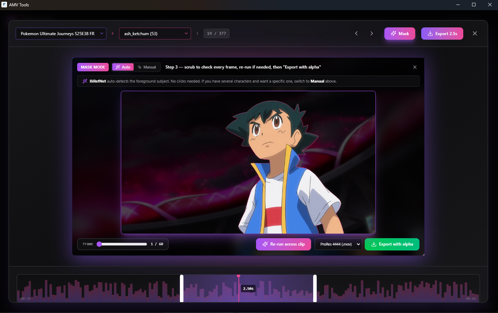

# Cut-outs: roto editor (beta) and Mask Mode (beta, off by default)

[← Back to the README](../README.md)

## Roto Editor (beta) — The AI Cuts Out, You Finish

Open any shot in the editor and press **Cut out this shot** (*Détourer ce
plan*). The AI makes the first pass over the whole shot (the Stable Auto
pipeline below: BiRefNet's soft edge, SAM 3 picks the characters, SAM 2.1
tracks them, the black ink line kept); you fix what it got wrong in a few
gestures, the way Roto Brush (After Effects) or Magic Mask (Resolve) work:

- **Brush**: green adds to the character, red removes; `[` `]` size, `E`
  eraser (puts the AI back), Ctrl+Z / Ctrl+Shift+Z. The edge of a stroke
  snaps to the drawn line next to it.
- **Clicks**: click a missing part to add it, Alt-click / right-click a piece
  of background to remove it (SAM 2.1). The corrected frame is on screen
  0.1 to 0.2 s later on an RTX 3090 (the measured time is shown). `Delete`
  empties a frame where the character is hidden or off screen.
- **Propagate** (← ↔ →): SAM 2.1's video tracker starts again from your
  corrected frames and carries the fixes along the shot; frames you corrected
  or validated (`V`) are never overwritten.
- **Frames to check**: the timeline marks in red the frames that probably need
  a look (character lost, sudden jump, specks, object lost, hole, jagged
  edge); `N` / `Shift+N` jump to the next / previous one.
- **Edges** (optional): keep the black line, soften / harden, grow / shrink,
  smoothing over time — applied live to the preview.
- Views: red overlay, on black / white / checkerboard, original; zoom
  (wheel), pan (space + drag), full screen (`F`). Several characters as
  layers. Saved automatically: close it, come back later.
- **Export**: ProRes 4444 with alpha (clean background, decontaminated edge
  colours), PNG sequence with alpha and the black-and-white matte, for After
  Effects, Premiere, Resolve or Vegas; the cut-out shot also goes into your
  selection and the timeline export places the cut-out clip.

Works on NVIDIA, Apple Silicon and CPU. Without access to SAM 3 (gated on
Hugging Face) the editor says so and uses SAM 2.1 large; on a CPU, clicks and
propagation are slower (the wait is shown) and propagation follows the
corrections by optical flow. Measured results: [reports/v06-roto-editeur.md](reports/v06-roto-editeur.md).

## Alpha Cutouts (Mask Mode, beta, off by default)

Mask Mode cuts characters out of a clip and exports them with transparency
(ProRes 4444 or VP9 alpha) for After Effects. **Still disabled
by default** — enable it from `Settings > Models`.

- **Auto** (no click): a detector finds the characters on every frame, the
  *main character* or *all characters* are picked automatically, and SAM 2.1
  tracks them through the clip — re-detecting them after a hard cut or when
  the track drifts. Brush corrections become keyframes and are re-propagated.
  On NVIDIA cards (8 GB and up), **SAM 3** (text concept "anime character")
  first tells the characters from auras, props and scenery, then the final
  matte is hugged to its outline, which removes the background left between
  the arms, under the chin and between hair spikes. SAM 3's weights are gated
  on Hugging Face: accept its license with your account and paste your token
  in `Settings > Models`; without access, Auto runs as in 0.5.
  In Stable and max quality SAM 3 also finds what the characters hold or wear (a staff,
  a halo, a sword, a bowl...) and puts it back in the cutout instead of
  cutting it off (`Keep held objects`, on by default).
- **Manual**: click a character and it is the whole detected character that
  is tracked (not just the colour patch under the click); a box prompt still
  goes straight to SAM 2. Clicks on several frames are keyframes.
- Long shots are tracked window by window, so a 10 s+ shot no longer runs out
  of memory (11 s shot: 2.1 GB of VRAM instead of 9.0 GB).
- **Stable** (default on NVIDIA 8 GB and up with SAM 3; the standard
  pipeline is the automatic fallback elsewhere): nothing disappears. The
  outline model's matte is kept wherever it touches a character — hair,
  edges and held objects (a cigarette, a staff) are never cut; SAM 3 only
  removes scenery detached from the characters and oversized pieces sticking
  out of them (aura flares); a frame where the character would vanish
  (camera shake, motion blur, flash) takes its neighbours' matte; loose
  background specks are cleaned the same way on every frame; the
  character's outer ink line is added, opaque; the outline itself is the
  outline model's own soft edge (scaled up onto the full-resolution art,
  as in 0.4), never redrawn. A little background can remain, to brush
  away.
- **Max quality** (*Settings > Models > Cutout mode*): SAM 3 runs a second, zoomed
  pass on each character, the matte hugs SAM 3's outline tightly but gives
  back the hair tips SAM 3 misses, loose fragments are dropped, and the
  export re-solves the outline from the local colours (ink line protected)
  — the least background in the hair, slower.
- Clean edges at export: the matte is exported as computed and the colour of
  every semi-transparent edge pixel is decontaminated (foreground
  estimation), so no ring or tint of the old background is left around hair
  (ProRes 4444, VP9 and PNG).

Measured on 23 real episode shots (see [Rotoscope Notes](#rotoscope-notes)
and [the report](reports/chantier-roto.md)): calm shots, dialogue,
crowds and most action shots come out usable; auras, smoke and
characters glued to a background object still need the brush.
Models download on demand and are chosen per memory tier: BiRefNet (MIT,
pinned revision), SAM 2.1 (Apache-2.0) and SAM 3 (SAM License, gated, see
below); ISNet anime (Apache-2.0) and
ToonOut (MIT weights, CC-BY-4.0 dataset) are available as alternative
detectors. **MatAnyone is not shipped**: its S-Lab 1.0 license is
**non-commercial**, so if you install it yourself (see `pyproject.toml`),
Mask Mode's MatAnyone engine uses it and your cutouts fall under that
license.

## Rotoscope Notes

> The roto workflow is **beta and disabled by default.** Enable it under
> `Settings > Models`.

Trim the clip in the mini editor first: the mask session follows the trim
range. Shots of any length work — beyond 4 s they are tracked window by
window with bounded memory.

How the engines work (0.5, with the 0.6 character pick):

- **Auto**: the detector (BiRefNet; ISNet anime on CPU) runs on every frame,
  the *main character* (biggest, most central) or *all characters* are picked
  on the clearest frame of each shot, and SAM 2.1 tracks them. Where the
  track drifts away from what the detector sees, or after a hard cut, it
  re-seeds itself. Only the detector components belonging to the tracked
  character are kept, so a second character or a house that the detector
  also found does not leak in.
- **Character pick (SAM 3, NVIDIA)**: before tracking, the detector's matte is
  kept only near what SAM 3 calls an "anime character" (an aura, a tractor
  or a pillar the detector found salient is cut); after tracking, the matte
  is hugged to SAM 3's outline (0.8 % of the frame diagonal), which removes
  the background between the arms, under the chin and between hair spikes
  while the detector still draws the hair and the ink line. A frame where SAM
  3 sees nobody keeps the detector's matte. Off switch: `Character pick with
  SAM 3` in `Settings > Models`.
- **Held objects (Stable and max quality)**: the same SAM 3 pass looks for weapon,
  sword, staff, halo, bowl, hammer and cup; an instance that touches a
  character, that the detector sees as foreground, that does not glow (energy
  beams and ki flames are effects) and that persists over neighbouring frames
  is given back with the detector's outline. Off switch: `Keep held objects`.
- **Manual**: a click selects the detected character under it (then tracked
  like Auto); a box goes to SAM 2 as before. Without a GPU tier (CPU) clicks
  go to SAM 2 directly.

Correcting a matte:

- `Brush +` / `Brush −` paint the matte of the current frame. The corrected
  frame is pinned and becomes a keyframe of the tracker: **Re-propagate**
  repairs the neighbouring frames too.
- Scrub to any frame and click there — every clicked frame is a keyframe.
- `Checkerboard` / `Color` show the actual cutout (with the export cleanup)
  instead of the darkened overlay, which is how edge halos are judged.

Useful settings:

- `Auto model` / `SAM 2 variant`: *Auto* picks per memory tier (see the tier
  table in `Settings > Models`). `toonout` and `anime` are alternative
  detectors; on real episodes BiRefNet general measured best.
- `Cutout mode`: *Stable* (default where the tier supports it, see above),
  *Max quality* (tight outline: the least background, but it can eat edges
  and props and lose a blurred character) or *Standard* (the first 0.6
  pipeline).
- `Clean edge colours at export` (on): matte exported as computed + edge
  colour decontamination. The 0.4/0.5 guided-filter export painted a ring of
  the old background around hair (background along the outline 4.0 % ->
  9.2 % on the benchmark's simple shots); switching this off brings it back,
  together with `Edge refine at export` / `BG-aware edge cleanup`, which only
  apply then.
- `Roto resolution`, `Temporal smoothing`, `RGB decontaminate export`,
  `Soft-alpha BG cleanup`: unchanged since 0.4.

What to expect (23 real shots, see [reports/chantier-roto.md](reports/chantier-roto.md)): calm
shots, dialogue, several characters, long hair and most fast action are
usable as is or with a few brush strokes. Still weak: auras and energy
effects (the detector keeps the glow), characters coming out of smoke, and a
character glued to a background object (a tractor) — fix those with the
brush or a box in Manual.

Measuring it: `uv run python -m tests.eval.roto_eval --help` (extract shots,
build and review reference masks, run a method, score, render boards). The
synthetic benchmark of 0.4 is still there: `uv run python -m
backend.finish.bench_mask`.
