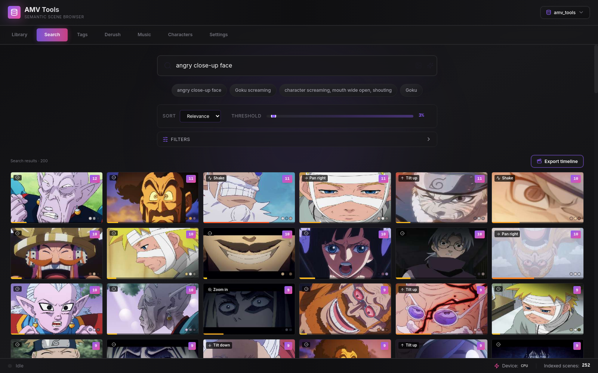
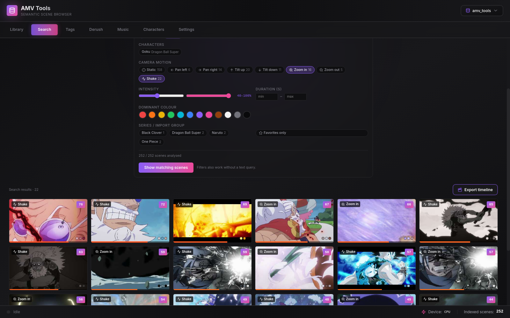

# Search, filters, similar shots and characters

[← Back to the README](../README.md)

## Search Like An Editor

Semantic search gives you a contact sheet of matching shots instead of forcing
you to remember filenames. Sort by relevance, tune the threshold, and hover
through results until the right movement, pose, or color lands. You can also
drop an image to search by visual reference.

**Finer search (v0.4).** Every scene also gets a camera-motion label (static,
pan left/right, tilt up/down, zoom in/out, shake) with a magnitude, an
intensity score (motion, rapid sub-cuts, flashes, luminance swings) and a
3-colour palette. They are computed on CPU during indexing from the frames the
cut detector already decodes, and older libraries are analysed in the
background shortly after launch (progress in the status bar; turn it off in
`Settings > Search > Automatically analyse existing scenes` and run it on
demand from `Filters > Analyse existing scenes`) — no re-index needed. The collapsible **Filters** panel combines
characters, motion, intensity, duration, dominant colour, series and favorites
with a text or image query — or on their own ("every zoom-in of Gojo with
intensity > 70 %"). Cards show a motion icon, an intensity bar and the palette.

**Similar shots.** From any scene — Search, Tags, Derush, the mini editor —
`Similar shots` lists the nearest scenes by their existing SigLIP 2 embedding
(optionally excluding the same episode or staying in the same series).

**Characters.** The Characters tab turns a few example scenes (or dropped
reference images, or a crop of a scene around the character) into a SigLIP 2
prototype, scores every scene of the chosen series, and lets you validate or
reject results to refine it. Characters are saved in the library and work as
search filters, and naming one in a query ("gojo running") boosts its scenes.
No extra model is downloaded: crops and dropped images reuse SigLIP 2, plain
scene examples reuse the stored embeddings.
